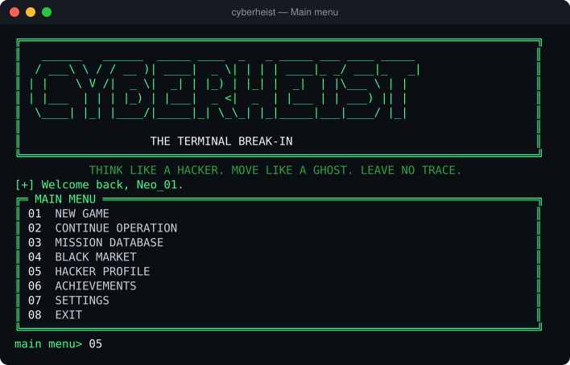
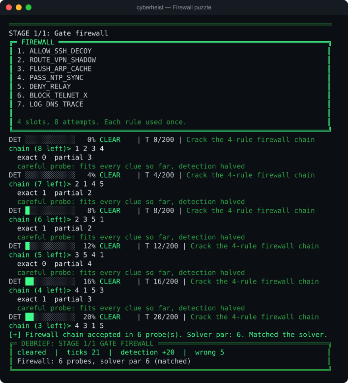
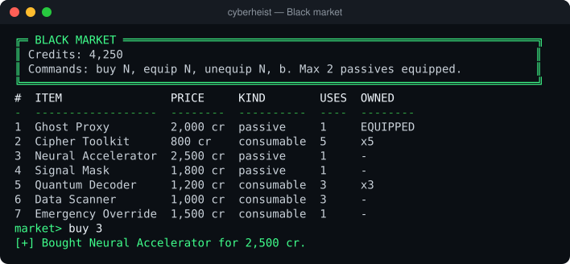
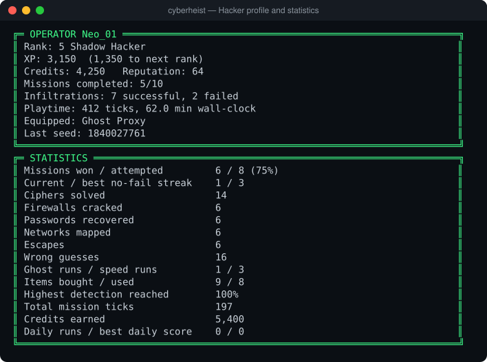

# CYBERHEIST: THE TERMINAL BREAK-IN

[](https://github.com/Kaushik2210/CYBERHEIST/actions/workflows/tests.yml)


[](LICENSE)

**THINK LIKE A HACKER. MOVE LIKE A GHOST. LEAVE NO TRACE.**

An ASCII cyberpunk puzzle game for the terminal. Everything is fictional and runs
locally: every "network", password and file is generated game data. There is no
networking and no real tool or target anywhere in the code.

<p align="center">
  
</p>

> **Status:** the engine, all challenge types except extraction, the systems and the
> full menu are built and tested. The 10-mission campaign (`missions/mission_data.py`)
> and the data-extraction challenge (`challenges/extraction.py`) are **not written
> yet**. See [Known limitations](#known-limitations).

## Screenshots

Captured from real game runs with `python tools/screenshots.py`.

| | |
|---|---|
|  |  |
| **Main menu** | **Firewall:** Mastermind-style rule chain with the detection HUD |
|  |  |
| **Cipher lab:** hints and the `apply KEY` tool | **Password:** pattern clues and per-position marks |
|  |  |
| **Network:** scan layer by layer, then pick a route | **Escape:** beat the tick countdown |
|  |  |
| **Black market** | **Profile and statistics** |

<p align="center">
  
</p>

## Setup

Python 3.11 or newer. The game uses the standard library only; pytest is needed only
to run the tests.

Windows (PowerShell or CMD):

```bash
python -m venv .venv
```
```bash
.venv\Scripts\activate
```
```bash
pip install -r requirements-dev.txt
```

Linux / macOS:

```bash
python3 -m venv .venv
```
```bash
source .venv/bin/activate
```
```bash
pip install -r requirements-dev.txt
```

## Launch

```bash
python main.py
```

| Flag | What it does |
|---|---|
| `--seed N` | Reproducible run. The seed of each mission is shown on the profile screen; include it in bug reports. |
| `--reset-save` | Moves the current save to `save.reset-<timestamp>.db` and starts fresh. Nothing is deleted. |
| `--save-path PATH` | Use a different save file. Default: `~/.cyberheist/save.db`. |

Set `NO_COLOR=1` to turn colour off. A terminal of at least 80×24 is recommended; the
game warns if it is smaller.

## Controls

Everywhere: type a menu number (`1` or `01`), `b` to go back, `?` for help.

In a mission, at any prompt:

| Command | Effect |
|---|---|
| `status` | Show the HUD (detection bar, status, ticks, objective) |
| `inv` | List equipped gear and consumables |
| `use toolkit` / `use decoder` / `use override` | Use a consumable on the current puzzle (a charge is only spent if it has an effect) |
| `use intel` | Spend intel banked from a random event |
| `?` | Help for the current stage |

Between stages: ENTER continues, `P` opens the pause menu (resume or abort).

| Stage | Commands |
|---|---|
| Tutorial shell | `help`, `scan`, `connect <host>`, `ls`, `cat <file>`, `status` |
| Network | `scan`, `map`, `routes`, `route N` |
| Firewall | rule numbers in order, e.g. `1 4 2 6` |
| Cipher lab | the plaintext; `hint`, `shift N` (Caesar, layered), `apply KEY` (Vigenère), `unhex` (layered) |
| Password | a full guess matching the pattern; marks are `+` right place, `~` elsewhere, `.` absent |
| Escape | an option number, or the displayed code |

Black market: `buy N`, `equip N`, `unequip N`, `b`. Up to 2 passives equipped.

## Features (mapped to the spec)

| Spec | Where | Status |
|---|---|---|
| §0 stdlib only, Windows ANSI, never crash on bad input | `interface/theme.py`, `core/game.py` (`_guarded`) | Done |
| §1 layout, settings.json balance | `config/settings.json` | Done |
| §2 tick clock, seeded RNG, detection meter, solvability, difficulty | `missions/mission_runner.py`, `core/rng.py`, `challenges/detection.py` | Done |
| §3 boot, logo with ASCII fallback, registration, 01–08 menu, briefing, HUD, map, results, stats, pause, `b`/`?`, themes, `NO_COLOR`, size warning, optional bell | `interface/`, `core/game.py` | Done |
| §4 profile, 8 ranks, rewards, Ghost/Speed bonuses | `core/player.py`, `core/progression.py` | Done |
| §5A network mapping | `challenges/network.py` | Done |
| §5B firewall | `challenges/firewall.py` | Done |
| §5C encryption lab (6 types, plus a layered hex-over-Caesar cipher) | `challenges/encryption.py` | Done |
| §5D password | `challenges/password.py` | Done |
| §5E detection monitor | `challenges/detection.py` | Done |
| §5F data extraction | `challenges/extraction.py` | **Not written** |
| §5G escape sequence | `challenges/escape.py` | Done |
| §6 10-mission campaign | `missions/mission_data.py` | **Not written** (runner, briefing, rewards and unlock order are ready) |
| §7 black market, inventory, equip limit | `systems/black_market.py`, `systems/inventory.py` | Done |
| §8 random events (fair) | `systems/random_events.py` | Done |
| §9 achievements | `systems/achievements.py` | Done |
| §10 SQLite save, migrations, integrity check, quarantine, Ctrl+C save, manual save | `database/` | Done |
| §11 tests | `tests/` | Done for everything that exists |

## Adding the campaign

`core/game.py` loads `MISSIONS` from `missions/mission_data.py` if that file exists.
Each entry is a `missions.mission_runner.Mission` with an id, title, tier, story text,
objectives, `stages`, tick numbers and rewards. A stage looks like:

```python
{"type": "firewall", "label": "Gate", "params": {"pool": 6, "length": 4, "attempts": 8}}
```

Stage types: `shell`, `network`, `firewall`, `cipher` (`kind`: caesar, vigenere,
substitution, binary, hex, pattern, layered; optional `tough`), `password`, `escape`. Any stage can add
`"patrol": N` to raise detection by N per tick while it runs. Optional objectives use
`kind` `max_ticks`, `max_detection`, `hidden_node` or `no_wrong`.

## Tests

```bash
python -m pytest -q
```

The suite includes 500-seed solvability checks for every challenge type, save
corruption and migration tests, and scripted end-to-end runs through every main-menu
option (using small test missions, since the campaign is not installed).

## Known limitations

- **No campaign yet.** Missions 1–10 are not defined, so CONTINUE and MISSION DATABASE
  report that no missions are installed. The scripted campaign test from §11 cannot
  run until they exist.
- **No data extraction.** Missions 4, 5, 8 and 10 need it, and the Data Scanner has
  nothing to act on until it exists.
- Sound is the terminal bell only, and off by default.
- Time is measured in ticks, not seconds; nothing happens while you think.
- Box-drawing characters fall back to ASCII when the terminal encoding can't print
  them, but colour support depends on the terminal.

## Contributing

Contributions are welcome, especially the campaign missions and the data-extraction
challenge. See [CONTRIBUTING.md](CONTRIBUTING.md) for setup, rules and how to open a
pull request.

## License

[MIT](LICENSE) © 2026 Kaushik

## Engineering decisions

- **Tough cipher lab on Normal and Hard.** The Vigenère keyword is hidden: you get
  the first word of the message and the key length, and work the key out yourself.
  Caesar loses its "the shift is N" hint, hex and binary carry longer words with no
  first-letter hint, pattern locks add alternating and cube sequences, and every
  `shift`, `apply` or `unhex` adds 2% detection. Easy keeps the gentler lab. A stage can
  force either mode with `"tough": true/false`.

- **Stage cooldown.** Clearing a stage lowers detection by 12 (`stage_cooldown`).
  Without it, back-to-back puzzles at +8 per wrong guess push late missions to 100%
  almost every run.
- **Solvability by construction.** Firewall and password generators run a solver on
  each puzzle and raise the attempt limit to what it needed, so no seed is unwinnable.
  Cipher puzzles are checked by decoding them from what the player is shown.
- **Firewall update event** costs ticks but leaves the answer unchanged. Reshuffling
  the rules would throw away everything the player had already deduced.
- **Random events** can't push detection above 80% or spend the last tick of the
  budget, and roll at most once per 10-tick block. They are off unless a mission
  enables them.
- **Speed Demon** requires strictly fewer ticks than par.
- **Firewall tokens never repeat** in a chain, which keeps feedback easy to read.
- **Abort** from the pause menu counts as a failed infiltration. Quitting with Ctrl+C
  instead keeps a checkpoint you can resume.
- **End of input** (a closed pipe) saves and quits rather than being read as a command.
