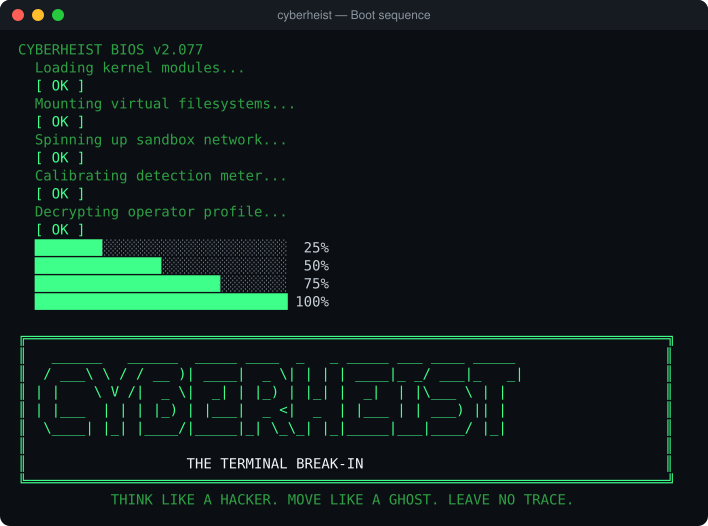
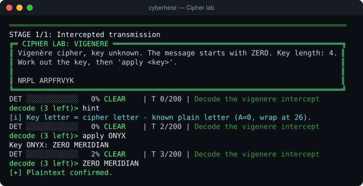
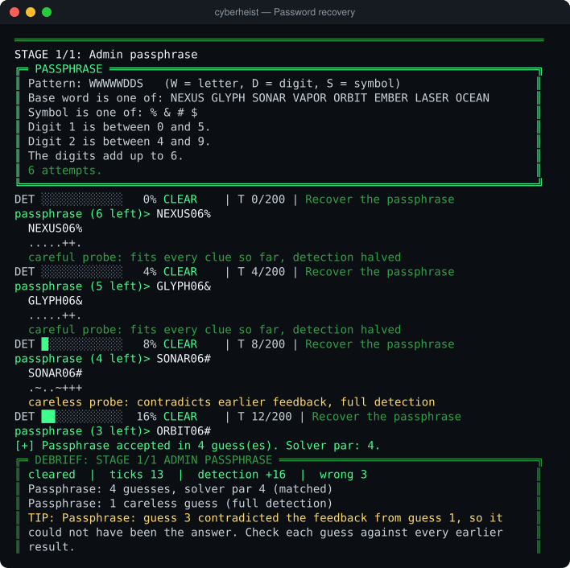
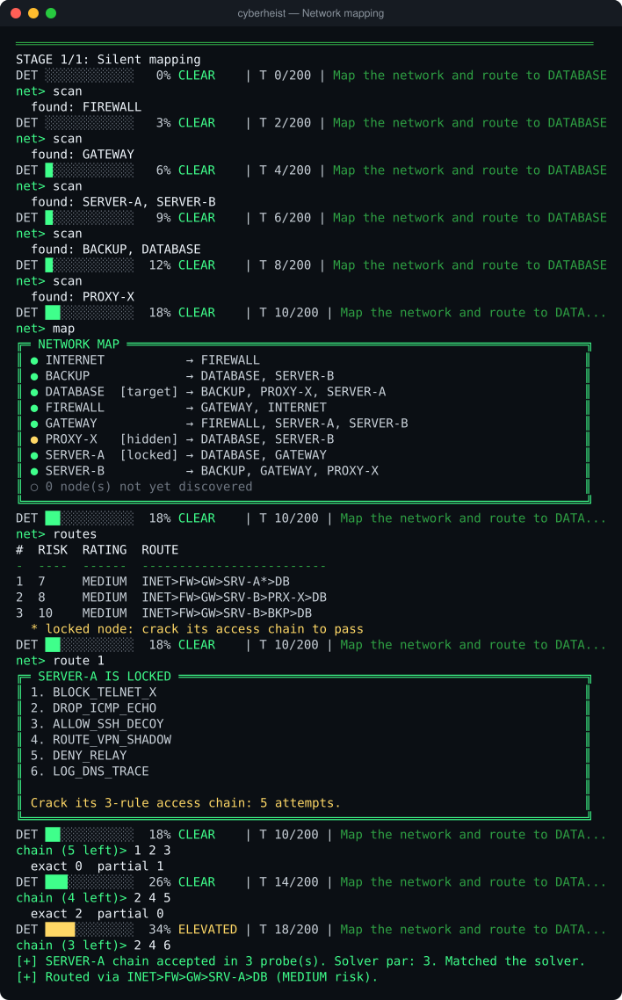
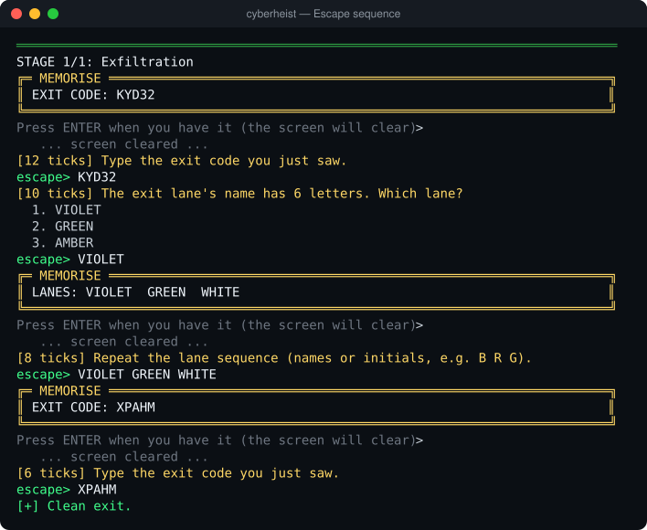
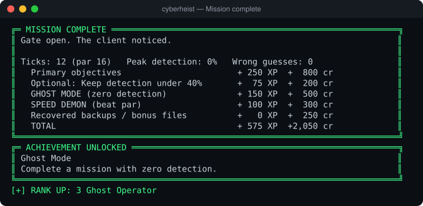
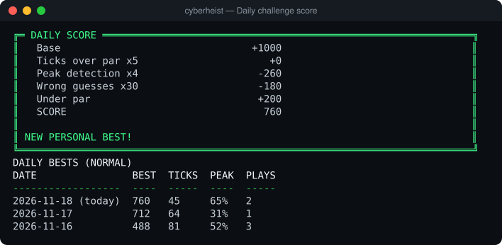

# CYBERHEIST: THE TERMINAL BREAK-IN

[](https://github.com/Kaushik2210/CYBERHEIST/actions/workflows/tests.yml)


[](LICENSE)
[](https://github.com/Kaushik2210/CYBERHEIST/releases)

**THINK LIKE A HACKER. MOVE LIKE A GHOST. LEAVE NO TRACE.**

An ASCII cyberpunk puzzle game for the terminal. Everything is fictional and runs
locally: every "network", password and file is generated game data. There is no
networking and no real tool or target anywhere in the code.

<p align="center">
  
</p>

> **Status:** the engine, all challenge types except extraction, the systems and the
> full menu are built and tested. The 10-mission campaign and the data-extraction challenge (`challenges/extraction.py`) are **not written
> yet**, but missions can now be written as plain TOML files (see
> [Adding the campaign](#adding-the-campaign)). See [Known limitations](#known-limitations).

## Screenshots

Captured from real game runs with `python tools/screenshots.py`.

| | |
|---|---|
|  |  |
| **Main menu** | **Firewall:** Mastermind-style rule chain with the detection HUD |
|  |  |
| **Cipher lab:** hints and the `apply KEY` tool | **Password:** pattern clues and per-position marks |
|  |  |
| **Network:** scan layer by layer, then pick a route | **Escape:** memorise, the screen clears, answer before the countdown ends |
|  |  |
| **Black market** | **Profile and statistics** |

|  |  |
|---|---|
| **Mission complete:** itemised rewards and an achievement | **Daily challenge:** score card and your daily bests |

## Replay features

- **Daily challenge.** In MISSION DATABASE, press `d`. Every player gets the same
  five-stage run each day (network, firewall, cipher, password, escape), built from the
  date plus a puzzle version (seed `2026111801` is 18 Nov 2026, version 1). It works even
  before the campaign is installed.
- **Versioned daily puzzles.** If an update changes which puzzles a date produces,
  `DAILY_VERSION` in `systems/daily.py` goes up. Each version gets new seeds and its own
  score boards, so scores only compare runs that faced the same puzzles. A fingerprint
  test fails with a reminder if generation changes without a bump.
- **Best score per seed.** Each daily run is scored: 1000 base, minus 5 per tick over
  par, 4 per % of peak detection and 30 per wrong guess, plus 200 for beating par and
  300 for a ghost run. Your best per day and difficulty is saved and shown as a board.
  Daily runs pay out XP and credits based on the score.
- **Adaptive difficulty.** Turn it on in SETTINGS. Two failures in a row step the
  difficulty down. Three clean wins in a row (peak detection under 40%) step it up.

## Install and play

Python 3.11 or newer. No other dependencies.

The quickest way is [pipx](https://pipx.pypa.io/), which installs the game in its own
environment and gives you a `cyberheist` command:

```bash
pipx install git+https://github.com/Kaushik2210/CYBERHEIST
```
```bash
cyberheist
```

To pin the first release, add `@v0.1.0` to the URL. To update later:

```bash
pipx upgrade cyberheist
```

You can also run it straight from a clone with `python main.py`. Prefer pipx (or a
virtual environment) over a global `pip install`: the game ships top-level modules with
generic names (`core`, `config`, `database`, …) that could clash with other packages.

## Development setup

pytest is the only extra needed, and only to run the tests.

Windows (PowerShell or CMD):

```bash
python -m venv .venv
```
```bash
.venv\Scripts\activate
```
```bash
pip install -r requirements-dev.txt
```

Linux / macOS:

```bash
python3 -m venv .venv
```
```bash
source .venv/bin/activate
```
```bash
pip install -r requirements-dev.txt
```

## Launch

```bash
python main.py
```

(or `cyberheist` if you installed with pipx; the flags are the same)

| Flag | What it does |
|---|---|
| `--version` | Print the installed version. |
| `--seed N` | Reproducible run. The seed of each mission is shown on the profile screen; include it in bug reports. |
| `--reset-save` | Moves the current save to `save.reset-<timestamp>.db` and starts fresh. Nothing is deleted. |
| `--save-path PATH` | Use a different save file. Default: `~/.cyberheist/save.db`. |

Set `NO_COLOR=1` to turn colour off. A terminal of at least 80×24 is recommended; the
game warns if it is smaller.

## Controls

Everywhere: type a menu number (`1` or `01`), `b` to go back, `?` for help.

In a mission, at any prompt:

| Command | Effect |
|---|---|
| `status` | Show the HUD (detection bar, status, ticks, objective) |
| `inv` | List equipped gear and consumables |
| `use toolkit` / `use decoder` / `use override` | Use a consumable on the current puzzle (a charge is only spent if it has an effect) |
| `use intel` | Spend intel banked from a random event |
| `?` | Help for the current stage |

Between stages: ENTER continues, `P` opens the pause menu (resume or abort).

| Stage | Commands |
|---|---|
| Tutorial shell | `help`, `scan`, `connect <host>`, `ls`, `cat <file>`, `status` |
| Network | `scan`, `map`, `routes`, `route N` (a locked node on the route asks for its access chain first) |
| Firewall | rule numbers in order, e.g. `1 4 2 6` (on Hard a rule may repeat: `1 1 4 2`) |
| Cipher lab | the plaintext; `hint`, `shift N` (Caesar, layered), `apply KEY` (Vigenère), `unhex` (layered) |
| Password | a full guess matching the pattern; marks are `+` right place, `~` elsewhere, `.` absent |
| Escape | an option number or lane name, a code, or a lane sequence from memory (names or initials: `B R G`) |

Black market: `buy N`, `equip N`, `unequip N`, `b`. Up to 2 passives equipped.

## Features (mapped to the spec)

| Spec | Where | Status |
|---|---|---|
| §0 stdlib only, Windows ANSI, never crash on bad input | `interface/theme.py`, `core/game.py` (`_guarded`) | Done |
| §1 layout, settings.json balance | `config/settings.json` | Done |
| §2 tick clock, seeded RNG, detection meter, solvability, difficulty | `missions/mission_runner.py`, `core/rng.py`, `challenges/detection.py` | Done |
| §3 boot, logo with ASCII fallback, registration, 01–08 menu, briefing, HUD, map, results, stats, pause, `b`/`?`, themes, `NO_COLOR`, size warning, optional bell | `interface/`, `core/game.py` | Done |
| §4 profile, 8 ranks, rewards, Ghost/Speed bonuses | `core/player.py`, `core/progression.py` | Done |
| §5A network mapping | `challenges/network.py` | Done |
| §5B firewall | `challenges/firewall.py` | Done |
| §5C encryption lab (6 types, plus a layered hex-over-Caesar cipher) | `challenges/encryption.py` | Done |
| §5D password | `challenges/password.py` | Done |
| §5E detection monitor | `challenges/detection.py` | Done |
| §5F data extraction | `challenges/extraction.py` | **Not written** |
| §5G escape sequence | `challenges/escape.py` | Done |
| §6 10-mission campaign | `missions/campaign/*.toml` | **Not written** (file format, loader, checker, runner, rewards and unlock order are ready) |
| §7 black market, inventory, equip limit | `systems/black_market.py`, `systems/inventory.py` | Done |
| §8 random events (fair) | `systems/random_events.py` | Done |
| §9 achievements | `systems/achievements.py` | Done |
| §10 SQLite save, migrations, integrity check, quarantine, Ctrl+C save, manual save | `database/` | Done |
| §11 tests | `tests/` | Done for everything that exists |

## Adding the campaign

Missions are plain TOML files, one per mission, so you can write them without touching
Python. The game reads `missions/campaign/` and then `~/.cyberheist/missions/`:

```toml
id = 1
title = "Practice Run"
# ...story text, tick budget and rewards...

[[stages]]
type = "firewall"
label = "Perimeter lock"
params = { pool = 6, length = 4 }
```

Check them before playing:

```bash
cyberheist --check-missions
```

The checker lists every problem in every file. It then plays each mission with the
autopilot on all three difficulties and flags any the autopilot can't clear on Easy.
Bad files are skipped, never crash the game. The full format, with every stage param
and its range, is in [docs/mission-format.md](docs/mission-format.md). A working
example is in [docs/examples/example-mission.toml](docs/examples/example-mission.toml).

## Tests

```bash
python -m pytest -q
```

The suite includes 500-seed solvability checks for every challenge type, save
corruption and migration tests, and scripted end-to-end runs through every main-menu
option (using small test missions, since the campaign is not installed).

## Known limitations


- **No campaign yet.** Missions 1–10 are not written, so CONTINUE and MISSION DATABASE
  report that no missions are installed. Add mission files to fix that. The scripted campaign test from §11 cannot
  run until they exist.
- **No data extraction.** Missions 4, 5, 8 and 10 need it. Until it exists, the Data
  Scanner reveals hidden network nodes instead of hidden files.
- Sound is the terminal bell only, and off by default.
- Time is measured in ticks, not seconds; nothing happens while you think.
- Box-drawing characters fall back to ASCII when the terminal encoding can't print
  them, but colour support depends on the terminal.

## Contributing

Contributions are welcome, especially the campaign missions and the data-extraction
challenge. See [CONTRIBUTING.md](CONTRIBUTING.md) for setup, rules and how to open a
pull request.

## License

[MIT](LICENSE) © 2026 Kaushik

## Engineering decisions

- **Careful probes cost half.** A wrong firewall or password guess normally adds 8%
  detection. If the guess fits every clue you've seen so far, it's a *careful probe*
  and adds only 4% (`careful_probe` in `settings.json`). A guess that contradicts
  earlier feedback still costs the full 8%, and the game tells you which kind you made.
  This rewards logic over guessing. Before this change, a logic-perfect autopilot
  cleared only 7 of 30 Hard daily runs; now it clears 26 of 30 (average peak detection
  74%), and Easy and Normal stay at 30 of 30. `tests/test_replay.py` guards the balance.

- **Memory-based escape on Normal and Hard.** Rounds no longer show you the answer:
  a code (5 characters, 6 on Hard) or a lane sequence (3 lanes, 4 on Hard) appears,
  the screen clears when you press ENTER, and you type it from memory. Clue rounds
  ask for "the only warm-coloured lane" or "the lane that comes last alphabetically",
  and each clue fits exactly one lane. A missed round shows the item again but costs
  ticks and detection. Easy keeps the original rounds.

- **Tougher passwords on Normal and Hard.** Normal widens each digit range to 6 values,
  adds a "the digits add up to N" clue, and gives the solver's guess count plus 2
  attempts. Hard hides the word list: you get 2–5 letter clues ("Contains E", "Ends
  with N", "No letter appears twice") that narrow the game's dictionary to a few
  words, never to one. Hard also uses 7-value digit ranges and par + 1 attempts. The
  game shows your guesses against the solver's par. Settings are in `settings.json`
  (`password_*`) or per stage.

- **Network trade-offs on Normal and Hard.** Each `scan` adds 3% detection, and a
  deep scan that turns up a hidden node adds 6%. The safest route always runs through
  a locked node, and taking it means cracking that node's 3-rule access chain first.
  At least one route is always unlocked, so you choose: crack the lock (ticks, and
  detection for every wrong probe) or take a riskier open route (+5% to +20%). Set
  per stage with `tough` and `locks`.

- **Tight firewall on Normal and Hard.** Each lock is played first by the built-in
  solver, and its guess count is the lock's *par*. Easy gives at least the mission's
  attempt count. Normal gives par + 2, Hard gives par + 1 and lets a rule appear more
  than once in the chain (about 5× more possible chains). When you crack it, the game
  shows your probes against the solver's par. Set per difficulty in `settings.json`
  (`firewall_margin`, `firewall_repeats`) or per stage (`margin`, `repeats`).

- **Tough cipher lab on Normal and Hard.** The Vigenère keyword is hidden: you get
  the first word of the message and the key length, and work the key out yourself.
  Caesar loses its "the shift is N" hint, hex and binary carry longer words with no
  first-letter hint, pattern locks add alternating and cube sequences, and every
  `shift`, `apply` or `unhex` adds 2% detection. Easy keeps the gentler lab. A stage can
  force either mode with `"tough": true/false`.

- **Stage cooldown.** Clearing a stage lowers detection by 12 (`stage_cooldown`).
  Without it, back-to-back puzzles at +8 per wrong guess push late missions to 100%
  almost every run.
- **Solvability by construction.** Firewall and password generators run a solver on
  each puzzle and raise the attempt limit to what it needed, so no seed is unwinnable.
  Cipher puzzles are checked by decoding them from what the player is shown.
- **Firewall update event** costs ticks but leaves the answer unchanged. Reshuffling
  the rules would throw away everything the player had already deduced.
- **Random events** can't push detection above 80% or spend the last tick of the
  budget, and roll at most once per 10-tick block. They are off unless a mission
  enables them.
- **Speed Demon** requires strictly fewer ticks than par.
- **Firewall tokens never repeat** in a chain, which keeps feedback easy to read.
- **Abort** from the pause menu counts as a failed infiltration. Quitting with Ctrl+C
  instead keeps a checkpoint you can resume.
- **End of input** (a closed pipe) saves and quits rather than being read as a command.
